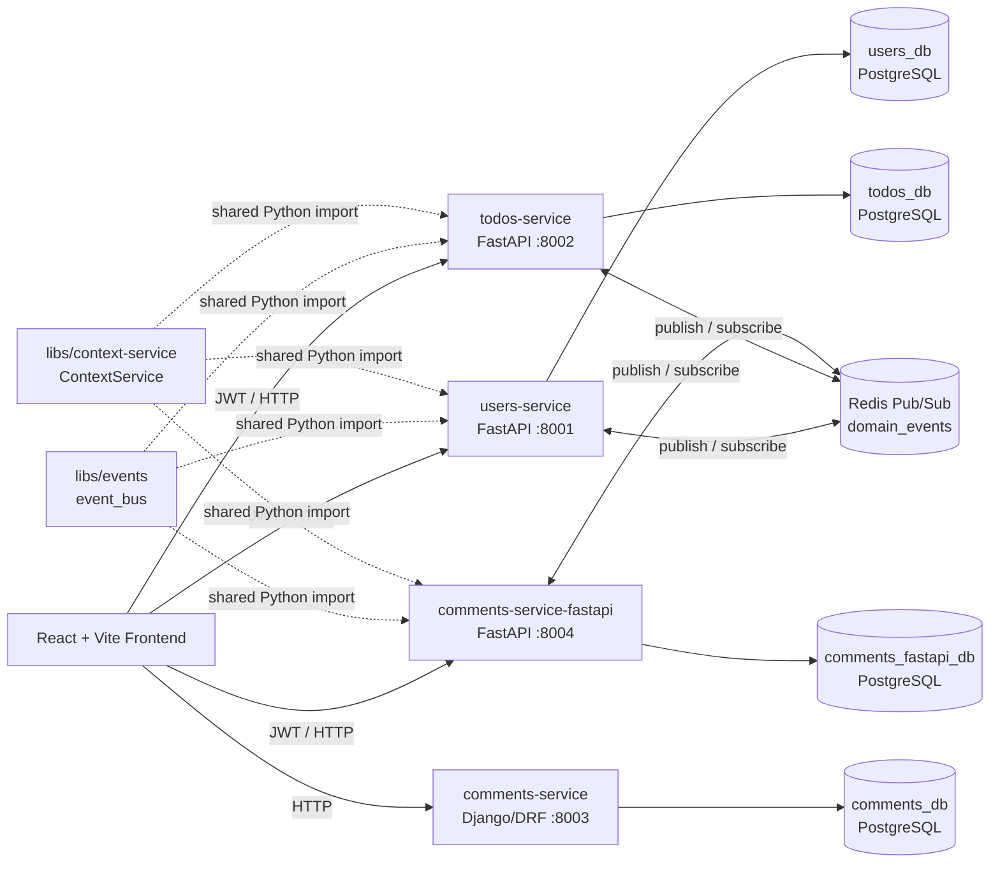
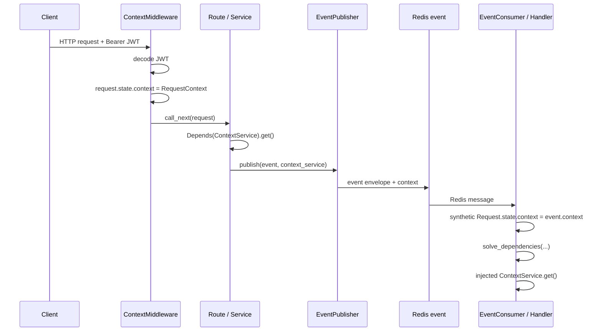

# Monorepo Todo Platform — Architecture Rebuild Blueprint

**Author:** Manus AI  
**Purpose:** This document is a standalone technical specification for rebuilding the repository from scratch. It captures the intended architecture, directory layout, responsibilities, data contracts, dependency-injection rules, eventing model, context propagation model, API surface, development workflow, and acceptance criteria.

> **Primary design principle:** Build independently deployable services with strict data ownership. Services never query each other’s databases, and no database-level foreign key crosses a service boundary. Relationships are expressed only as opaque IDs and coordinated through APIs or domain events.

---

## 1. Scope and Non-Negotiable Requirements

The repository is an **Nx-managed monorepo** for a Todo application with authentication, todo management, and two functionally comparable comment-service implementations. The frontend is a React application. The backend contains independent Python services. The FastAPI services share class-based dependency injection, a repository pattern, request context propagation, and Redis Pub/Sub eventing. The Django service exists only as a comparison implementation of the comment domain and is not required to participate in the FastAPI event bus.

| Area | Required implementation |
|---|---|
| Monorepo tool | Nx, using explicit `project.json` files and `nx:run-commands` targets for Python projects |
| Frontend | React 19, Vite, TypeScript, React Router, API clients, authentication context |
| User service | FastAPI, async SQLAlchemy, Pydantic v2, JWT authentication, PostgreSQL |
| Todo service | FastAPI, async SQLAlchemy, Pydantic v2, PostgreSQL |
| Comments service (comparison A) | Django + Django REST Framework, Django ORM, PostgreSQL |
| Comments service (comparison B) | FastAPI, async SQLAlchemy, Pydantic v2, PostgreSQL |
| Persistence isolation | A distinct database per backend service; no foreign keys across service boundaries |
| FastAPI structure | Route → service → repository → model, with class-based `Depends(...)` injection |
| Context | `ContextService` injected by `Depends(ContextService)`, reading `request.state.context` |
| Events | Redis Pub/Sub, one domain-event envelope, context propagated with every event |
| Event consumption | Handlers use FastAPI’s DI resolution against a synthetic `Request` object |
| Testing layout | Tests live in top-level `tests/`, never inside an application directory |
| Deployment | Every backend service has its own Dockerfile and can be deployed independently |

FastAPI can resolve a class as a dependency by examining its constructor and recursively resolving its constructor parameters. This is the foundation for the required `Depends(UserService)`, `Depends(TodoService)`, `Depends(CommentService)`, and `Depends(ContextService)` style.[1]

---

## 2. Logical System Architecture



The **Django comments service** and **FastAPI comments service** expose the same comment-domain behavior so the implementation approaches can be compared. The FastAPI version is the event-enabled version. In a production deployment, choose one implementation as the authoritative comments service; do not run two services that both own the same business capability unless comparison is deliberately required.

---

## 3. Required Repository Layout

Use the following directory structure. The most important placement rule is that application source is kept below `backend/apps` or `frontend/apps`, while all test source lives below the root-level `tests` directory.

```text
monorepo-example/
├── backend/
│   └── apps/
│       ├── users-service/                 # FastAPI, port 8001
│       │   ├── app/
│       │   │   ├── api/v1/routes/
│       │   │   ├── core/
│       │   │   ├── db/
│       │   │   ├── models/
│       │   │   ├── repositories/
│       │   │   ├── schemas/
│       │   │   ├── services/
│       │   │   ├── event_handlers.py
│       │   │   └── main.py
│       │   ├── alembic/
│       │   ├── Dockerfile
│       │   ├── requirements.txt
│       │   ├── .env.example
│       │   └── project.json
│       ├── todos-service/                 # FastAPI, port 8002
│       │   └── ... same FastAPI shape ...
│       ├── comments-service/              # Django + DRF comparison, port 8003
│       │   ├── config/
│       │   ├── comments/
│       │   │   ├── api/
│       │   │   ├── repositories/
│       │   │   ├── services/
│       │   │   ├── migrations/
│       │   │   └── models.py
│       │   ├── manage.py
│       │   ├── Dockerfile
│       │   ├── requirements.txt
│       │   ├── .env.example
│       │   └── project.json
│       └── comments-service-fastapi/      # FastAPI comparison, port 8004
│           └── ... same FastAPI shape ...
├── frontend/
│   └── apps/
│       └── frontend/                      # React 19 + Vite, port 5173 / 3000
│           ├── src/app/
│           │   ├── api/
│           │   ├── contexts/
│           │   └── pages/
│           ├── Dockerfile
│           ├── nginx.conf
│           └── project.json
├── libs/
│   ├── events/
│   │   ├── event_bus/
│   │   │   ├── schemas.py
│   │   │   ├── publisher.py
│   │   │   ├── consumer.py
│   │   │   └── dependencies.py
│   │   └── project.json
│   └── context-service/
│       ├── context_service/
│       │   ├── models.py
│       │   ├── service.py
│       │   ├── middleware.py
│       │   └── dependencies.py
│       └── project.json
├── tests/
│   ├── users-service-tests/
│   ├── todos-service-tests/
│   ├── comments-service-tests/
│   ├── comments-service-fastapi-tests/
│   └── frontend-e2e/
├── docker-compose.yml
├── Makefile
├── nx.json
├── pnpm-workspace.yaml
├── package.json
└── ARCHITECTURE_BLUEPRINT.md
```

| Path | Responsibility |
|---|---|
| `backend/apps/*` | Deployable backend applications only. Do not place tests here. |
| `frontend/apps/frontend` | The deployable browser application. |
| `libs/events` | Shared, framework-aware FastAPI event infrastructure. |
| `libs/context-service` | Shared FastAPI request-context abstraction. |
| `tests/*-tests` | Separate Nx projects that depend on the application under test. |
| `tests/frontend-e2e` | Playwright end-to-end test project. |

---

## 4. Nx Model and Affected-Project Behavior

Use one `project.json` per application, shared library, and standalone test project. Python projects use explicit `nx:run-commands` targets because the repository does not rely on Nx’s automatic Python import analysis. Nx supports project-level configuration and manual `implicitDependencies` where a dependency cannot be statically inferred.[3]

### 4.1 Application project conventions

Every backend application must have a `project.json` with these minimum target categories.

| Target | Intent | Example command |
|---|---|---|
| `serve` | Start a local development process | `uvicorn app.main:app --reload --port 8001` |
| `test` | Run application-level checks if any exist | Prefer delegating to the independent test project |
| `lint` | Lint app source | `python -m ruff check app/` |
| `migrate` | Apply schema migrations | Alembic or `manage.py migrate` |
| `docker-build` | Build only that service image | `docker build -t users-service:latest .` |

Use tags consistently:

```json
{
  "tags": ["scope:backend", "type:service", "lang:python"]
}
```

### 4.2 Test projects must be independent Nx projects

The tests for `users-service` belong in `tests/users-service-tests`, not in `backend/apps/users-service/tests`. The test project must carry an explicit reverse dependency:

```json
{
  "name": "users-service-tests",
  "projectType": "library",
  "sourceRoot": "tests/users-service-tests",
  "implicitDependencies": ["users-service"],
  "targets": {
    "test": {
      "executor": "nx:run-commands",
      "options": {
        "cwd": "tests/users-service-tests",
        "command": "python -m pytest unit/ integration/ -v"
      }
    }
  }
}
```

This produces the intended affected behavior.

| File changed | Expected affected projects |
|---|---|
| `tests/users-service-tests/unit/...` | Only `users-service-tests` |
| `backend/apps/users-service/app/...` | `users-service` and `users-service-tests` |
| `libs/events/...` | Every FastAPI service and its related test projects |
| `libs/context-service/...` | Every FastAPI service and its related test projects |

> Do not claim that Nx automatically discovers Python import edges unless a Python graph plugin has been intentionally added and configured. With the baseline design, `implicitDependencies` provides the required dependency edges manually.

### 4.3 Python shared-library import strategy

The shared Python libraries must be importable in development, test, and container runtime. Choose one approach and apply it consistently.

| Option | Recommended use |
|---|---|
| Add shared library paths to `PYTHONPATH` | Simple baseline for this repository. Add `/workspace/libs/events` and `/workspace/libs/context-service` in local targets and container environment. |
| Package each shared library with `pyproject.toml` and install it | Better for production maturity. Use editable/path dependencies per service. |
| Use a Python Nx plugin | Optional future enhancement if automatic Python dependency inference is required. |

The rebuild must not rely on an accidental local import path. The Docker images must explicitly copy and expose the shared libraries or install them as packages.

---

## 5. Service Catalog and Deployment Boundaries

| Service | Framework | Port | Own database | Responsibility | Event participant |
|---|---:|---:|---|---|---|
| `users-service` | FastAPI | 8001 | `users_db` | Registration, login, user profile, password change, JWT issuance | Publisher and consumer |
| `todos-service` | FastAPI | 8002 | `todos_db` | Todo CRUD and user-scoped queries | Publisher and consumer |
| `comments-service` | Django + DRF | 8003 | `comments_db` | Comment CRUD comparison implementation | No, comparison only |
| `comments-service-fastapi` | FastAPI | 8004 | `comments_fastapi_db` | Comment CRUD comparison implementation with event support | Publisher and consumer |
| `frontend` | React + Vite | 5173 dev / 3000 container | None | Browser UI, token storage, API calls | No |
| `redis` | Redis 7 | 6379 | Redis-managed | Pub/Sub transport for domain events | Infrastructure |

Every backend service is independently deployable. It has a dedicated Dockerfile, independent environment configuration, its own database URL, and no source-level dependency on another application service.

> **Naming rule:** The Django and FastAPI comment implementations must have distinct event producer identifiers. Use `comments-service-fastapi` for events emitted by the FastAPI version. Do not emit both implementations as `comments-service`, because consumers would be unable to distinguish their origin.

---

## 6. Data Ownership and Database Rules

Each backend service owns exactly one database schema. A service may store IDs that identify records owned by another service, but those IDs are plain values and never foreign keys.

### 6.1 Cross-service reference policy

| Rule | Required behavior |
|---|---|
| Cross-service foreign keys | Forbidden |
| Cross-service joins | Forbidden |
| Shared database/schema | Forbidden |
| Reference to remote entity | Store `VARCHAR(36)` / UUID string only |
| Remote record validation | Use the owning service’s API or accept eventual consistency through events |
| Remote deletion handling | React to a `*.deleted` event; do not use a cascade foreign key |

### 6.2 Core tables

#### `users_db.users`

| Column | Type / behavior | Notes |
|---|---|---|
| `id` | UUID string, primary key | Generated by users service |
| `email` | String, unique, indexed | Login identity |
| `username` | String, unique, indexed | Display identity |
| `hashed_password` | String | Never expose in API response |
| `is_active` | Boolean | Reject inactive login |
| `created_at` | UTC datetime | Audit field |
| `updated_at` | UTC datetime | Audit field |

#### `todos_db.todos`

| Column | Type / behavior | Notes |
|---|---|---|
| `id` | UUID string, primary key | Generated by todos service |
| `user_id` | `VARCHAR(36)`, indexed, **not a foreign key** | Loose reference to user owner |
| `title` | String | Required |
| `description` | Nullable text | Optional |
| `status` | Enum/string: `pending`, `in_progress`, `done` | Use a SQLite-compatible non-native enum in local dev if needed |
| `due_date` | Nullable datetime/date | Optional |
| `created_at` | UTC datetime | Audit field |
| `updated_at` | UTC datetime | Audit field |

#### `comments_db.comments` and `comments_fastapi_db.comments`

Both comment implementations must use the same logical schema.

| Column | Type / behavior | Notes |
|---|---|---|
| `id` | UUID string, primary key | Generated locally |
| `user_id` | `VARCHAR(36)`, indexed, **not a foreign key** | Loose reference to users service |
| `todo_id` | `VARCHAR(36)`, indexed, **not a foreign key** | Loose reference to todos service |
| `body` | Text, required | Comment body |
| `status` | `active` or `deleted` | Soft-delete contract |
| `created_at` | UTC datetime | Audit field |
| `updated_at` | UTC datetime | Audit field |

### 6.3 Migration rules

| Service | Migration tool | Required command |
|---|---|---|
| `users-service` | Alembic | `alembic upgrade head` |
| `todos-service` | Alembic | `alembic upgrade head` |
| `comments-service-fastapi` | Alembic | `alembic upgrade head` |
| `comments-service` | Django migrations | `python manage.py migrate` |

For local sandbox-only experimentation, SQLite may be used by changing the service database URL to `sqlite+aiosqlite:///./<service>.db` for FastAPI or SQLite settings for Django. Production must use the separate PostgreSQL databases described above.

---

## 7. FastAPI Application Architecture

All FastAPI services use the same strict layering. The HTTP route handler is deliberately thin; it must not access SQLAlchemy directly.

```mermaid
flowchart LR
    Route[APIRouter route] -->|Depends(Service)| Service[Service layer]
    Service -->|Depends(Repository)| Repo[Repository layer]
    Repo -->|Depends(get_db)| Session[AsyncSession]
    Session --> DB[(Service-owned PostgreSQL)]

    Route -->|Depends(ContextService)| Context[ContextService]
    Service -->|Depends(ContextService)| Context
    Service -->|Depends(get_event_publisher)| Publisher[EventPublisher]
    Publisher --> Redis[(Redis)]
```

### 7.1 Layer contracts

| Layer | Directory | Responsibility | Must not do |
|---|---|---|---|
| Model | `app/models/` | SQLAlchemy table mapping | Contain HTTP behavior or business rules |
| Schema | `app/schemas/` | Pydantic request/response validation | Query the database |
| Repository | `app/repositories/` | All SQLAlchemy persistence operations | Raise HTTP-specific errors or publish events |
| Service | `app/services/` | Business rules, authorization checks, transaction-aware domain work, event publication | Query with SQLAlchemy directly |
| Route | `app/api/v1/routes/` | HTTP validation, status code, dependency declaration | Construct dependencies manually |
| Main | `app/main.py` | Application factory, middleware, lifespan, routers | Contain business behavior |
| Event handlers | `app/event_handlers.py` | Subscribe to other services’ events and invoke injected services | Access database/session directly |

### 7.2 Required class-based injection style

Do not create aliases such as `UserSvc`, `TodoSvc`, `UserRepo`, or `DbSession`. Do not construct repositories or services manually in route handlers. Use full descriptive class names with `Depends(...)`.

```python
from fastapi import Depends
from sqlalchemy.ext.asyncio import AsyncSession

class TodoRepository:
    def __init__(self, session: AsyncSession = Depends(get_db)) -> None:
        self._session = session

class TodoService:
    def __init__(
        self,
        todo_repository: TodoRepository = Depends(TodoRepository),
        event_publisher: EventPublisher = Depends(get_event_publisher),
        context_service: ContextService = Depends(ContextService),
    ) -> None:
        self._repository = todo_repository
        self._publisher = event_publisher
        self._context = context_service

@router.post("/todos", response_model=TodoRead, status_code=201)
async def create_todo(
    data: TodoCreate,
    todo_service: TodoService = Depends(TodoService),
) -> TodoRead:
    return await todo_service.create_todo(data)
```

This pattern is valid because FastAPI treats classes as callable dependencies and resolves constructor parameters, including nested dependencies.[1]

### 7.3 Database session dependency

Each FastAPI service must expose one `get_db()` generator dependency.

```python
async def get_db() -> AsyncGenerator[AsyncSession, None]:
    async with AsyncSessionFactory() as session:
        try:
            yield session
            await session.commit()
        except Exception:
            await session.rollback()
            raise
        finally:
            await session.close()
```

This yields one session per dependency-resolution scope. Repositories receive the session through `Depends(get_db)`, and services receive repositories through `Depends(RepositoryClass)`.

### 7.4 Application lifespan

Every FastAPI application must use an async lifespan to initialize database metadata in local development, initialize the event infrastructure, register handlers, and stop background listeners cleanly.

```python
@asynccontextmanager
async def lifespan(app: FastAPI):
    async with engine.begin() as connection:
        await connection.run_sync(Base.metadata.create_all)  # local dev only

    init_event_bus(app, settings.REDIS_URL)

    consumer = EventConsumer(app=app, redis_url=settings.REDIS_URL)
    register_handlers(consumer)
    await consumer.start()

    yield

    await consumer.stop()
    await app.state.redis.aclose()
    await engine.dispose()
```

Production schema changes must come from migration jobs, not from `Base.metadata.create_all()`.

---

## 8. Request Context and Authentication

### 8.1 Goal

Replace per-route `get_current_user()` dependencies with a reusable `ContextService` that can be injected from anywhere in FastAPI’s dependency graph, including routes, services, repositories when necessary, and event-consumer handlers.

The mandatory route/service pattern is:

```python
context_service: ContextService = Depends(ContextService)
context = context_service.get()
```

For an authentication guard, use a dependency that returns the same `ContextService` instance after checking the context:

```python
context_service: ContextService = Depends(require_authenticated)
context = context_service.get()  # authenticated: context.user_id is guaranteed
```

### 8.2 `RequestContext` contract

```python
class RequestContext(BaseModel):
    user_id: str | None = None
    username: str | None = None
    email: str | None = None
    is_active: bool = True
    roles: list[str] = []
    extra: dict[str, Any] = {}

    @property
    def is_authenticated(self) -> bool:
        return self.user_id is not None
```

The model must be serializable because it is included in event messages. Keep it small. Never put passwords, raw access tokens, database sessions, or sensitive unbounded request data into context.

### 8.3 `ContextService` design

`ContextService` is an injectable wrapper around the current `Request`.

```python
from fastapi import Depends, Request

class ContextService:
    def __init__(self, request: Request) -> None:
        self._request = request

    def get(self) -> RequestContext:
        return getattr(self._request.state, "context", RequestContext())

    def set(self, context: RequestContext) -> None:
        self._request.state.context = context
```

> **Implementation note:** `Request` is a special FastAPI-injected parameter. For this rebuild, declare `request: Request` in the constructor; FastAPI’s dependency resolver supplies the active request while resolving `Depends(ContextService)`. Do not create a process-global user context.

### 8.4 Context middleware

The HTTP middleware runs before route handling, decodes the Bearer JWT, and sets a plain request-state field.

```python
class ContextMiddleware(BaseHTTPMiddleware):
    async def dispatch(self, request: Request, call_next):
        request.state.context = self._resolve_context_from_bearer_token(request)
        return await call_next(request)
```

Middleware runs around request processing and may mutate request state before a path operation is reached.[2] Add `ContextMiddleware` as part of every FastAPI application factory.

### 8.5 JWT requirement

The user service must issue a JWT whose claims contain enough user details to populate the context without another service making a database call.

```json
{
  "sub": "user-uuid",
  "username": "alice",
  "email": "alice@example.com",
  "is_active": true,
  "roles": [],
  "exp": 1735689600
}
```

| Environment | Token validation rule |
|---|---|
| Local development | All FastAPI services may share one `JWT_SECRET_KEY` for HS256 validation. |
| Production | Prefer asymmetric JWT verification: users-service signs with a private key; consuming services verify using the public key or a JWKS endpoint. |
| Any environment | Do not use different unrelated HMAC secrets in each FastAPI service, or those services cannot build trusted user context from the issued user token. |

### 8.6 Context flow



---

## 9. Domain Events

### 9.1 Event envelope

Use one JSON envelope for every event.

```json
{
  "event_id": "c62d99f5-57b1-4a25-bb5f-e0d99c77e3f3",
  "event_type": "todo.created",
  "service": "todos-service",
  "occurred_at": "2026-08-12T12:00:00+00:00",
  "payload": {
    "todo_id": "todo-uuid",
    "user_id": "user-uuid",
    "title": "Ship eventing"
  },
  "context": {
    "user_id": "user-uuid",
    "username": "alice",
    "email": "alice@example.com",
    "is_active": true,
    "roles": [],
    "extra": {}
  }
}
```

| Field | Rule |
|---|---|
| `event_id` | UUID generated once per event. Use it in logs and idempotency storage. |
| `event_type` | Dot-namespaced stable contract, such as `user.deleted`. |
| `service` | Exact producer identity, such as `comments-service-fastapi`. |
| `occurred_at` | UTC ISO-8601 timestamp. |
| `payload` | Small business data needed by consumers. Never include secrets. |
| `context` | Serialized `RequestContext` from the original action. |

### 9.2 Event types

| Producer | Event types | Minimum payload |
|---|---|---|
| `users-service` | `user.created`, `user.updated`, `user.deleted` | Created: `user_id`, `email`, `username`; updated: `user_id`, `changes`; deleted: `user_id` |
| `todos-service` | `todo.created`, `todo.updated`, `todo.deleted` | Created: `todo_id`, `user_id`, `title`; updated: `todo_id`, `changes`; deleted: `todo_id` |
| `comments-service-fastapi` | `comment.created`, `comment.updated`, `comment.deleted` | Created: `comment_id`, `user_id`, `todo_id`; updated: `comment_id`, `changes`; deleted: `comment_id` |

### 9.3 Publication rule

Every successful mutating service operation publishes exactly one corresponding domain event.

| Service operation | Required event |
|---|---|
| Register user | `user.created` |
| Update user or change password | `user.updated` |
| Delete user | `user.deleted` |
| Create todo | `todo.created` |
| Update todo status/title/description | `todo.updated` |
| Delete todo | `todo.deleted` |
| Create comment | `comment.created` |
| Update comment body | `comment.updated` |
| Soft-delete comment | `comment.deleted` |

Publication belongs in the **service layer**, after repository mutation succeeds, because it is domain behavior rather than HTTP or storage mechanics.

```python
class TodoService:
    async def create_todo(self, data: TodoCreate) -> TodoRead:
        todo = await self._repository.create(data)
        result = TodoRead.model_validate(todo)

        await self._publisher.publish(
            TodoCreatedEvent(
                payload={
                    "todo_id": result.id,
                    "user_id": result.user_id,
                    "title": result.title,
                }
            ),
            context_service=self._context,
        )
        return result
```

> **Reliability boundary:** Redis Pub/Sub is intentionally lightweight and non-durable. The baseline design is suitable for a demonstration or low-risk asynchronous reactions. A production-grade rebuild must replace direct post-mutation publication with a transactional outbox, durable broker/stream, idempotent consumers keyed by `event_id`, retries, dead-letter handling, and observability. Do not promise exactly-once delivery with Redis Pub/Sub.

---

## 10. Event Bus Library

### 10.1 Public components

| Module | Component | Responsibility |
|---|---|---|
| `schemas.py` | `Event`, typed event subclasses | Validate and serialize event envelope |
| `dependencies.py` | `init_event_bus`, `get_event_publisher` | Store Redis client/publisher on `app.state`; expose publisher dependency |
| `publisher.py` | `EventPublisher` | Add `context` and publish JSON to `domain_events` |
| `consumer.py` | `EventConsumer` | Subscribe, parse, construct synthetic request, resolve handler dependencies, invoke handler |

### 10.2 Publisher

The application lifespan calls `init_event_bus(app, settings.REDIS_URL)`. It should store the shared connection and publisher on application state.

```python
def init_event_bus(app: FastAPI, redis_url: str) -> None:
    redis_client = redis.from_url(redis_url, decode_responses=True)
    app.state.redis = redis_client
    app.state.event_publisher = EventPublisher(redis_client)

async def get_event_publisher(request: Request) -> EventPublisher:
    return request.app.state.event_publisher
```

The publisher receives the `ContextService` explicitly from the business service so it can serialize the current `request.state.context`.

```python
async def publish(self, event: Event, context_service: ContextService) -> None:
    message = event.model_dump()
    message["context"] = context_service.get().model_dump()
    await self._redis.publish("domain_events", json.dumps(message, default=str))
```

### 10.3 Consumer: FastAPI DI outside HTTP

The key requirement is that an event handler can use FastAPI class dependencies just as an HTTP route does.

```python
@consumer.on("user.deleted")
async def handle_user_deleted(
    event: Event,
    todo_service: TodoService = Depends(TodoService),
    context_service: ContextService = Depends(ContextService),
) -> None:
    actor = context_service.get()
    response = await todo_service.list_todos_by_user(event.payload["user_id"])
    for todo in response.items:
        await todo_service.delete_todo(todo.id)
```

The consumer must perform the following exact sequence per message and per registered handler.

1. Parse the JSON event envelope.
2. Extract `context` before validating the base `Event` model.
3. Build a synthetic ASGI scope containing `app`.
4. Create `request = Request(scope)`.
5. Set `request.state.context = RequestContext.model_validate(context_data)`.
6. Build a FastAPI dependant object from the handler callable.
7. Call FastAPI’s dependency solver using the synthetic request and the FastAPI application as the dependency-overrides provider.
8. Add the plain `event` parameter to the solved keyword arguments.
9. Await the handler.
10. Log failures with the `event_id`, handler name, event type, and traceback.

```python
scope = {
    "type": "http",
    "method": "GET",
    "path": "/",
    "query_string": b"",
    "headers": [],
    "app": app,
}
request = Request(scope)
request.state.context = RequestContext.model_validate(context_data)

dependant = get_dependant(path="/", call=handler)
solved = await solve_dependencies(
    request=request,
    dependant=dependant,
    dependency_overrides_provider=app,
)
kwargs = solved.values
kwargs["event"] = event
await handler(**kwargs)
```

> **Compatibility rule:** `get_dependant` and `solve_dependencies` are FastAPI internals rather than a stable public event-consumer API. Pin the FastAPI version for this implementation, wrap the calls in a small adapter module, and cover the adapter with integration tests. A FastAPI upgrade must explicitly verify the event-consumer DI path.

### 10.4 Required consumer examples

The rebuild must include at least these concrete handlers:

| Consumer service | Event | Required behavior |
|---|---|---|
| `comments-service-fastapi` | `todo.deleted` | Find all active comments by `todo_id` and soft-delete them through `CommentService` |
| `comments-service-fastapi` | `user.deleted` | Find all active comments by `user_id` and soft-delete them through `CommentService` |
| `todos-service` | `user.deleted` | Find all todos by `user_id` and delete/archive them through `TodoService` |
| `todos-service` | `comment.created` | If the referenced todo is `pending`, update it to `in_progress` through `TodoService` |
| `users-service` | `todo.deleted` | Emit a structured audit/activity log using `event_id` and `occurred_at` |
| `users-service` | `comment.created` | Resolve comment author via `UserService`; show the notification/audit extension point |

All handlers must validate minimum payload fields, tolerate missing remote records caused by timing/race conditions, and avoid direct repository/session access. They must call their injected service layer.

---

## 11. Django Comparison Service Architecture

The Django comments implementation must expose the same business behavior as the FastAPI comments service but through Django conventions.

```text
comments-service/
├── config/
│   ├── settings.py
│   ├── urls.py
│   └── wsgi.py
├── comments/
│   ├── models.py
│   ├── repositories/
│   │   ├── base.py
│   │   └── comment_repository.py
│   ├── services/
│   │   └── comment_service.py
│   ├── api/
│   │   ├── serializers.py
│   │   ├── views.py
│   │   ├── urls.py
│   │   └── health.py
│   └── migrations/
└── manage.py
```

| Concern | Django implementation | FastAPI implementation |
|---|---|---|
| ORM | Django ORM, synchronous | SQLAlchemy 2.0 async |
| Input/output validation | DRF serializers | Pydantic v2 schemas |
| Routing | `urls.py`, `APIView` | `APIRouter`, async functions |
| Migrations | `makemigrations` / `migrate` | Alembic |
| Service composition | Explicit constructor composition in views | Class constructor graph through `Depends(...)` |
| Event bus | Not in scope for comparison service | Required |

The Django service keeps the same repository/service split. Views must call `CommentService`; they must not directly invoke ORM methods except inside repositories.

---

## 12. HTTP API Contract

All versioned APIs are under `/api/v1`. Enforce Pydantic/serializer validation, use predictable `404`, `401`, `403`, and `409` errors, and return only response-safe fields.

### 12.1 Users service — port 8001

| Method | Path | Auth | Behavior |
|---|---|---|---|
| `POST` | `/api/v1/users/register` | No | Create user; publish `user.created` |
| `POST` | `/api/v1/users/login` | No | Validate credentials; return JWT with context claims |
| `GET` | `/api/v1/users/me` | Required | Read user ID from `ContextService` and return user |
| `GET` | `/api/v1/users` | Define policy | Paginated user listing |
| `GET` | `/api/v1/users/{user_id}` | Define policy | Read user |
| `PATCH` | `/api/v1/users/{user_id}` | Define policy | Update user; publish `user.updated` |
| `PUT` | `/api/v1/users/{user_id}/password` | Required, self only | Change password; publish `user.updated` |
| `DELETE` | `/api/v1/users/{user_id}` | Define policy | Delete user; publish `user.deleted` |

### 12.2 Todos service — port 8002

| Method | Path | Auth | Behavior |
|---|---|---|---|
| `POST` | `/api/v1/todos` | Required | Create todo; source `user_id` from `ContextService` unless acting-on-behalf is an explicit feature; publish `todo.created` |
| `GET` | `/api/v1/todos` | Required | Paginated list or policy-scoped list |
| `GET` | `/api/v1/todos/user/{user_id}` | Required / authorization policy | List todos by loose user ID |
| `GET` | `/api/v1/todos/{todo_id}` | Required / authorization policy | Read todo |
| `PATCH` | `/api/v1/todos/{todo_id}` | Required / authorization policy | Update todo; publish `todo.updated` |
| `DELETE` | `/api/v1/todos/{todo_id}` | Required / authorization policy | Delete todo; publish `todo.deleted` |

### 12.3 FastAPI comments service — port 8004

| Method | Path | Auth | Behavior |
|---|---|---|---|
| `POST` | `/api/v1/comments` | Required | Create comment; source `user_id` from context; publish `comment.created` |
| `GET` | `/api/v1/comments` | Define policy | Paginated comment list |
| `GET` | `/api/v1/comments/todo/{todo_id}` | Define policy | List active comments for a todo |
| `GET` | `/api/v1/comments/user/{user_id}` | Define policy | List active comments by a user |
| `GET` | `/api/v1/comments/{comment_id}` | Define policy | Read active comment |
| `PATCH` | `/api/v1/comments/{comment_id}` | Required / owner policy | Update body; publish `comment.updated` |
| `DELETE` | `/api/v1/comments/{comment_id}` | Required / owner policy | Soft-delete; publish `comment.deleted` |

### 12.4 Django comments service — port 8003

Provide the same logical comment API, using Django/DRF conventions. A trailing slash may be required by Django routing, for example `GET /api/v1/comments/` and `GET /health/`.

---

## 13. Frontend Architecture

The frontend is a React 19 + Vite + TypeScript application under `frontend/apps/frontend`.

| Module | Responsibility |
|---|---|
| `src/app/api/usersApi.ts` | Calls user registration, login, and user profile endpoints |
| `src/app/api/todosApi.ts` | Calls todo CRUD endpoints |
| `src/app/contexts/AuthContext.tsx` | Stores JWT, exposes authenticated user/session actions, attaches `Authorization: Bearer <token>` |
| `src/app/pages/LoginPage.tsx` | Login form |
| `src/app/pages/RegisterPage.tsx` | Registration form |
| `src/app/pages/TodosPage.tsx` | Todo creation, reading, updates, deletes, and status columns |
| `src/styles.css` | Application-wide styling |

The rebuild must avoid nesting duplicate `<BrowserRouter>` providers. The application root should own exactly one router provider.

The frontend currently focuses on users and todos. Integrating comments into the UI is optional unless explicitly requested; the backend comparison services must still be independently testable through their HTTP APIs.

---

## 14. Docker, Compose, and Separate Deployment

### 14.1 Container rules

Each service receives a distinct production Dockerfile. The container must include only that service’s runtime dependencies plus the required shared Python library code or installed shared packages.

| Image | Port | Must include |
|---|---:|---|
| `users-service` | 8001 | service source, `libs/events`, `libs/context-service`, Python dependencies |
| `todos-service` | 8002 | service source, `libs/events`, `libs/context-service`, Python dependencies |
| `comments-service` | 8003 | Django source, Python dependencies |
| `comments-service-fastapi` | 8004 | service source, `libs/events`, `libs/context-service`, Python dependencies |
| `frontend` | 80 in container | Built Vite asset bundle served by Nginx |
| `redis` | 6379 | Redis 7 Alpine |

### 14.2 Compose topology

`docker-compose.yml` must define the following local-development services.

| Compose service | Dependencies |
|---|---|
| `redis` | None |
| `users-db` | None |
| `todos-db` | None |
| `comments-db` | None |
| `comments-fastapi-db` | None |
| `users-service` | `users-db`, `redis` |
| `todos-service` | `todos-db`, `redis` |
| `comments-service` | `comments-db` |
| `comments-service-fastapi` | `comments-fastapi-db`, `redis` |
| `frontend` | Backend API services as appropriate |

Use health checks for PostgreSQL and Redis. Do not block FastAPI on `depends_on` alone; the app should fail fast and be restarted if an infrastructure dependency is unavailable.

### 14.3 Environment variables

Use `.env.example` in every service. Never commit real production credentials.

| Variable | Services | Meaning |
|---|---|---|
| `DATABASE_URL` | All backend services | That service’s isolated database connection string |
| `JWT_SECRET_KEY` or `SECRET_KEY` | All FastAPI services | JWT verification secret/key material; must establish shared trust |
| `JWT_ALGORITHM` | All FastAPI services | `HS256` for simple dev setup or an asymmetric alternative in production |
| `REDIS_URL` | FastAPI services | Redis Pub/Sub connection string |
| `ALLOWED_ORIGINS` | FastAPI services | Frontend origins for CORS |
| `USERS_SERVICE_URL` | Todo/comments services if direct API validation is added | Users service base URL |
| `TODOS_SERVICE_URL` | Comments services if direct API validation is added | Todos service base URL |
| `DEBUG` | All backend services | Debug/logging switch |

---

## 15. Testing Strategy

### 15.1 Unit tests

Unit tests must mock repositories and event publishers, not databases.

| Project | Essential unit-test cases |
|---|---|
| `users-service-tests` | Registration conflicts, login rejection, user update event, delete event, password change event |
| `todos-service-tests` | Create/update/delete behavior, correct event payloads, user-deletion cascade handler, comment-created status handler |
| `comments-service-fastapi-tests` | Comment CRUD, soft delete, event publication, todo/user deletion cascade handlers |
| `comments-service-tests` | Django `CommentService` behavior and serializer validation |
| `context-service` tests | Middleware JWT-to-context conversion, anonymous context, `ContextService` reading request state |
| `events` tests | Event serialization, publisher embedding context, consumer synthetic request, DI resolving injected service/context |

### 15.2 Integration tests

Integration tests should use a temporary PostgreSQL instance or transaction-isolated test database. Test each migration chain, repository persistence behavior, FastAPI API surface, and the Redis consumer path.

The most important integration test is the **synthetic event request test**:

1. Create a FastAPI application with `ContextService`, a fake repository, and an event handler declaring `Depends(ContextService)` and `Depends(SomeService)`.
2. Dispatch a serialized event with a non-empty `context` object.
3. Assert that the handler receives the correctly injected service.
4. Assert that `context_service.get().user_id` equals the user ID in the event context.

### 15.3 End-to-end tests

Keep Playwright test source in `tests/frontend-e2e`. Cover registration, login, token persistence, create/update/delete todo, and authentication-guard behavior.

### 15.4 Event test rules

| Rule | Reason |
|---|---|
| Assert event type and minimum payload | Event contracts are service integration APIs |
| Assert context is attached | Ensures action identity survives async boundaries |
| Test missing IDs and deleted remote entities | Distributed systems have race conditions |
| Include `event_id` in logs | Required for traceability and deduplication later |
| Do not use sleep-based tests | Use deterministic consumer dispatch or test Redis container lifecycle |

---

## 16. Developer Commands

The root `Makefile` should provide discoverable commands that delegate to Nx or native migration tools.

```make
install:                 # pnpm install; install Python dependencies
lint:                    # lint all projects
test:                    # run all unit/integration tests
docker-up:               # docker compose up --build
docker-down:             # docker compose down
docker-logs:             # docker compose logs -f

dev-users:               # users-service on :8001
dev-todos:               # todos-service on :8002
dev-comments:            # Django comments-service on :8003
dev-comments-fastapi:    # FastAPI comments-service on :8004
dev-frontend:            # Vite frontend on :5173

migrate-users:           # Alembic users-service
migrate-todos:           # Alembic todos-service
migrate-comments:        # Django migrate
migrate-comments-fastapi:# Alembic FastAPI comments
migrate-all:             # all migration targets
```

Useful Nx commands:

```bash
pnpm nx graph
pnpm nx affected -t test
pnpm nx affected -t lint
pnpm nx run users-service:serve
pnpm nx run todos-service:serve
pnpm nx run comments-service-fastapi:serve
pnpm nx run users-service-tests:test
pnpm nx run frontend-e2e:e2e
```

---

## 17. Build Sequence for Another Agent

Rebuild in this order to avoid circular implementation assumptions.

| Step | Deliverable | Completion criterion |
|---:|---|---|
| 1 | Nx root workspace, pnpm workspace, folder structure | Nx recognizes every app/lib/test project |
| 2 | React frontend scaffold and Docker build | Vite builds; frontend has one router provider |
| 3 | Users FastAPI app | Migration, health endpoint, registration/login/JWT work |
| 4 | Todos FastAPI app | CRUD works against its own database; no user foreign key |
| 5 | Django comments app | CRUD works against its own database; no foreign keys |
| 6 | FastAPI comments app | Same comment behavior works independently |
| 7 | Shared `context-service` library | Middleware populates `request.state.context`; `Depends(ContextService)` reads it |
| 8 | Shared `events` library | Redis publisher/consumer runs; typed envelope is validated |
| 9 | Wire FastAPI service events | All mutation methods publish events with context |
| 10 | Wire consumer handlers | Synthetic request correctly enables class DI and context in event handlers |
| 11 | External tests under `tests/` | Test-only change does not affect app project; app change affects its test project |
| 12 | Docker Compose and CI | Each service can build/deploy independently; full local stack works |

---

## 18. Rebuild Acceptance Checklist

### Monorepo and Nx

- [ ] `backend/apps`, `frontend/apps`, `libs`, and `tests` exist exactly as described.
- [ ] No tests are stored inside an application project.
- [ ] Every app, shared library, and test project has a valid `project.json`.
- [ ] Every `*-tests` project has `implicitDependencies` on its corresponding application.
- [ ] `nx affected -t test` reflects the expected test/app dependency direction.

### Data and services

- [ ] Each backend service connects only to its own PostgreSQL database.
- [ ] No migration creates a cross-service foreign key.
- [ ] `todos.user_id`, `comments.user_id`, and `comments.todo_id` are plain indexed strings/UUIDs.
- [ ] All FastAPI database access is inside repositories.
- [ ] All FastAPI business logic and event publication is inside services.
- [ ] All HTTP routes inject services using full names such as `Depends(UserService)`.

### Context and authentication

- [ ] Every FastAPI app installs `ContextMiddleware`.
- [ ] Middleware sets `request.state.context` for authenticated and anonymous requests.
- [ ] JWT includes enough claims to populate `RequestContext` without a lookup.
- [ ] `ContextService` constructor depends on `Request` and `get()` reads `request.state.context`.
- [ ] Route/service code uses `context_service: ContextService = Depends(ContextService)`.
- [ ] Authentication-protected routes use `Depends(require_authenticated)` or an equivalent guard returning `ContextService`.

### Events

- [ ] Redis channel is named `domain_events`.
- [ ] Each successful CRUD mutation emits the correct typed event.
- [ ] Every event carries `event_id`, `event_type`, `service`, `occurred_at`, `payload`, and `context`.
- [ ] Event producer names distinguish `comments-service-fastapi` from the Django comparison service.
- [ ] Consumer builds a synthetic request, sets `request.state.context`, and uses FastAPI dependency resolution.
- [ ] Event handlers receive services and `ContextService` through `Depends(...)`.
- [ ] Event handlers invoke services, not repositories directly.

### Operational quality

- [ ] Every FastAPI service exposes `/health` and `/docs`.
- [ ] Django comments service exposes `/health/` and DRF routes.
- [ ] Every service has a Dockerfile and `.env.example`.
- [ ] Docker Compose starts Redis and a separate database for each backend service.
- [ ] Shared Python libraries are importable in local runs, tests, and containers.
- [ ] Unit, integration, synthetic-request, and Playwright E2E tests pass.

---

## 19. Implementation Warnings and Deliberate Trade-Offs

| Topic | Baseline decision | Production hardening direction |
|---|---|---|
| Event transport | Redis Pub/Sub | Redis Streams, RabbitMQ, Kafka, or another durable broker |
| Event delivery | At-most-once / best-effort | Transactional outbox, retries, dead-letter queue, idempotency table |
| Context identity | Context is copied from JWT/event envelope | Minimize claims; validate tenant/roles carefully; use signed verifiable identity |
| JWT trust | Shared HMAC secret acceptable for local development | Asymmetric signing/JWKS and key rotation |
| Synthetic FastAPI DI | Uses FastAPI dependency resolver for event handlers | Pin FastAPI and isolate internal calls behind an adapter |
| Comment services | Two implementations for comparison | Pick one owner before production to avoid duplicated source of truth |
| Nx Python graph | Manual project dependencies | Adopt a Python plugin and package metadata if import-aware graphing is needed |

---

## References

[1]: https://fastapi.tiangolo.com/tutorial/dependencies/classes-as-dependencies/ "FastAPI — Classes as Dependencies"
[2]: https://fastapi.tiangolo.com/tutorial/middleware/ "FastAPI — Middleware"
[3]: https://nx.dev/docs/reference/project-configuration "Nx — Project Configuration"

---

> **Final instruction to the rebuilding agent:** Preserve the boundaries and dependency directions in this document even if individual framework syntax changes. In particular, do not collapse services into a shared database, do not move tests back beneath apps, do not bypass repository/service layers, do not introduce abbreviated dependency aliases, and do not bypass FastAPI’s `Depends(...)` mechanism in event handlers. The architecture depends on those constraints.
